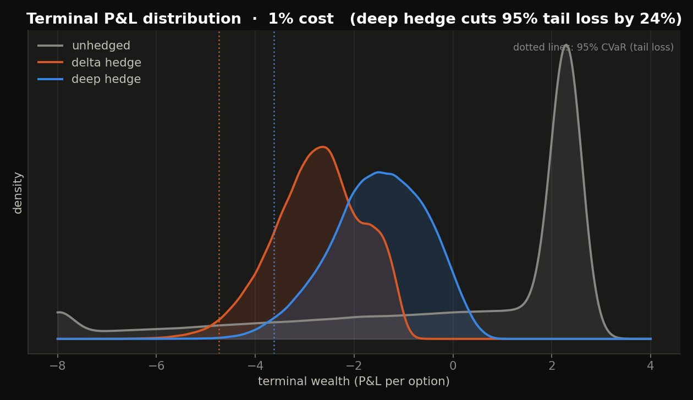
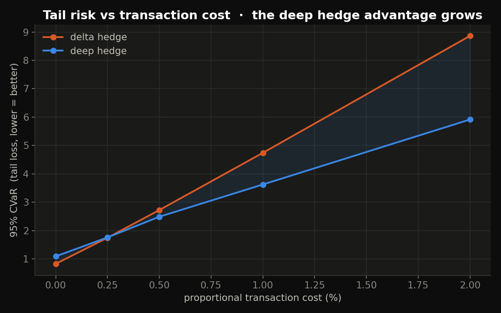
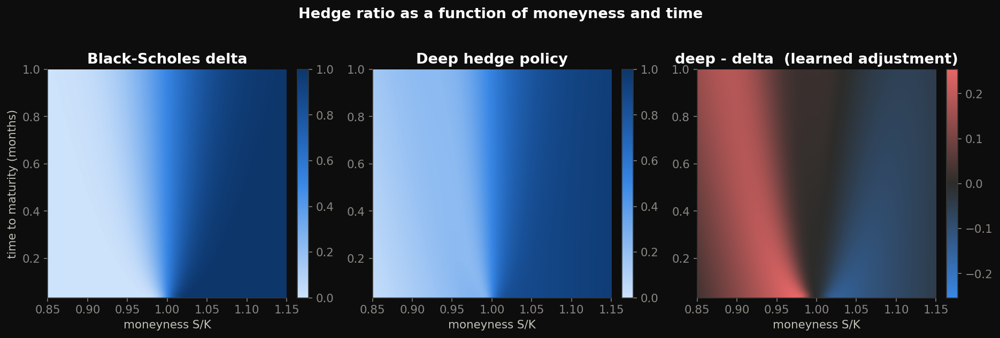
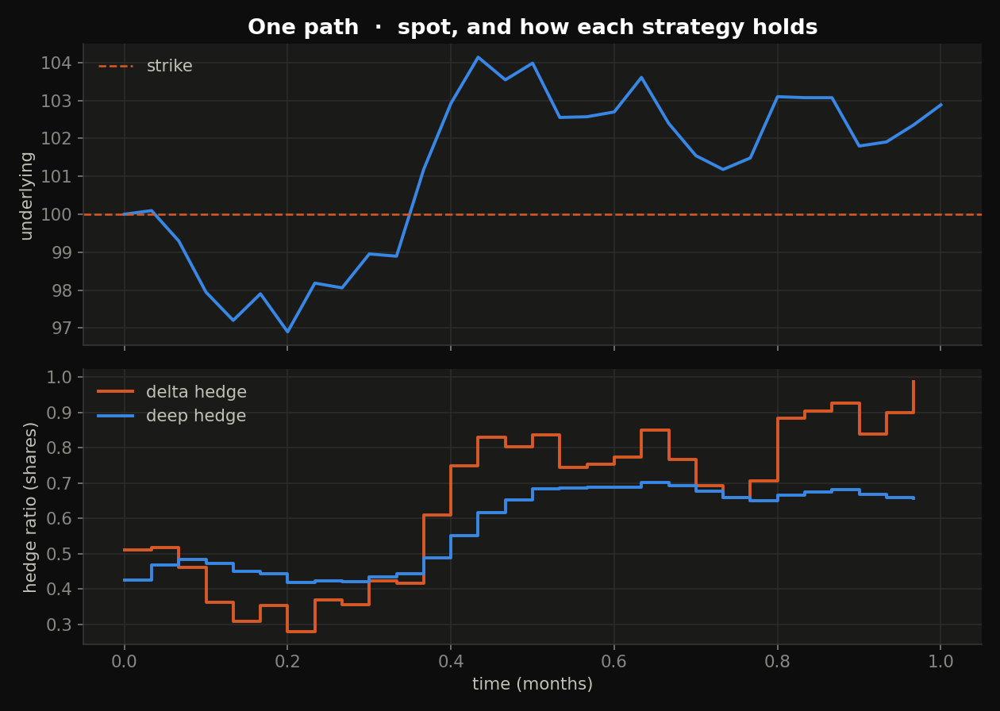
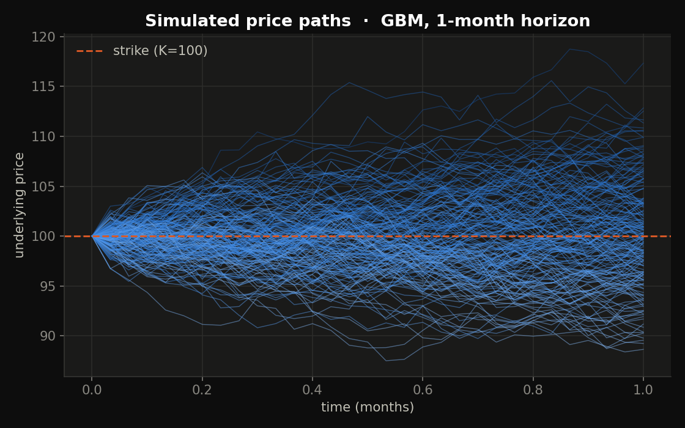
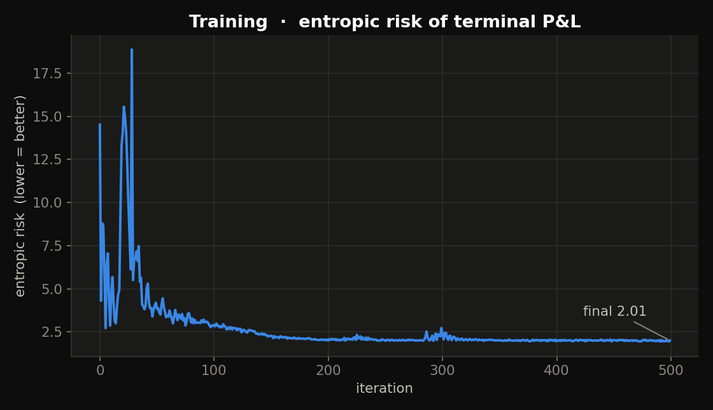
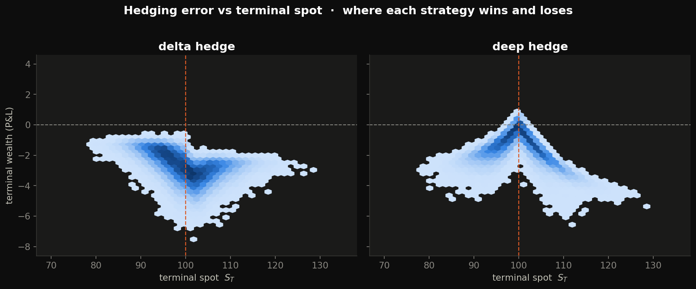

# deephedge


**Deep Hedging** — training a neural network to hedge options by minimizing the
*risk* of terminal P&L, rather than tracking the Black–Scholes delta. It
reproduces the central result of Buehler, Gonon, Teichmann & Wood (2019): under
transaction costs, a learned hedging policy delivers a tighter P&L distribution
and smaller tail risk than delta hedging.

The twist: **there's no PyTorch or JAX here.** The neural network is trained on a
~150-line reverse-mode **autodiff engine written from scratch on NumPy**, whose
every gradient is checked against finite differences. It clones and runs with
nothing heavier than NumPy, SciPy and Matplotlib.



## The result, honestly

The money plot is the cost frontier — and it's the one a quant should trust,
because it doesn't overclaim:



**At zero cost, delta hedging wins.** It is optimal in the Black–Scholes world,
and the network can only approximate it. The learned policy earns its keep
entirely in the transaction-cost regime, where the right thing to do is *trade
less* — and the advantage widens as costs rise. At 1% cost it cuts the 95% CVaR
(tail loss) by ~24%.

| strategy | mean | std | 95% CVaR | entropic risk |
|----------|------|-----|----------|---------------|
| delta hedge | −2.73 | 0.90 | 4.74 | 3.18 |
| **deep hedge** | **−1.50** | 0.96 | **3.63** | **2.00** |

*(short 1-month ATM call, σ=20%, daily rebalancing, 1% proportional cost)*

## What it learned

The network's policy is delta-*like* but deliberately damped. The difference
panel shows it holds **more** than delta out-of-the-money and **less**
in-the-money — flattening its response so it doesn't chase every spot move into a
transaction cost:



On a single path the mechanism is obvious — delta hedging whipsaws, the deep
hedge glides:



## The method

We are short one European call and receive its Black–Scholes premium. Hedging
with the underlying, terminal wealth is

```
W = premium + Σ_t H_t (S_{t+1} − S_t) − costs − payoff(S_T)
```

A perfect continuous, cost-free hedge gives `W = 0`. With discrete steps and
proportional costs it's a distribution, and we train the policy `H_t = f(state)`
to minimize the **entropic risk** `ρ(W) = (1/λ) log E[exp(−λW)]` — a smooth,
convex risk measure that punishes losses. The state is
`[log-moneyness, time-to-maturity, current holding]`; the loss backpropagates
through the entire unrolled hedging simulation.

## How it's built (and verified)

| File | What it is | Verified by |
|------|------------|-------------|
| `autodiff.py` | reverse-mode autodiff over NumPy | gradients vs finite differences (`test_autodiff.py`, ~1e-9) |
| `market.py` | GBM + Heston simulators, Black–Scholes | Monte-Carlo price → BS closed form |
| `hedge.py` | policy network, Adam, hedging sims, training | deep hedge beats delta under costs |
| `run.py` | trains everything, renders the figures | — |

## Run it

```sh
git clone https://github.com/b17w1z4rd/deephedge.git
cd deephedge
pip install numpy scipy matplotlib     # core is numpy-only; viz needs the rest

python3 test_autodiff.py               # gradient check
python3 market.py                      # MC price == BS
python3 hedge.py                       # train + compare to delta hedging
python3 run.py                         # train + render all 7 figures to figures/
```

`run.py` caches training to `figures/cache.npz`; re-run to redraw instantly, or
`python3 run.py --retrain` to recompute from scratch (~5 min, pure NumPy).

## Figure gallery

| | |
|---|---|
|  |  |
|  | Terminal-wealth vs terminal-spot, per strategy |

## Notes & scope

- Simulated markets (GBM + Heston), so it's fully reproducible with no data feed.
  Heston paths are included for a stochastic-vol stress test.
- The 1% headline cost is high on purpose, to make the effect vivid; the frontier
  spans 0–2%.
- Entropic risk is the training objective (smooth); CVaR and moments are reported
  at evaluation.

## Roadmap

- [ ] Hedge under Heston paths end-to-end (vol is already simulated)
- [ ] CVaR training objective via the Rockafellar–Uryasev form
- [ ] Multi-instrument hedging (add a second option to hedge vega)
- [ ] Recurrent policy (LSTM-style state) for path-dependent exotics

## References

- Buehler, Gonon, Teichmann, Wood — *Deep Hedging* (Quantitative Finance, 2019),
  [arXiv:1802.03042](https://arxiv.org/abs/1802.03042)
- Föllmer & Schied — *Stochastic Finance* (entropic / convex risk measures)

## License

MIT — see [LICENSE](LICENSE).
